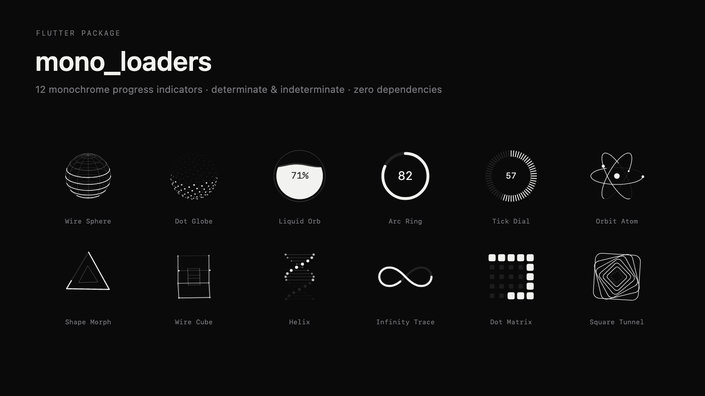

# mono_loaders



Modern **monochrome** progress indicators for Flutter: 3D wire & dot spheres, a liquid orb, morphing shapes, a rotating cube and more.

- 12 loaders, each with **determinate** (`progress: 0..1`) and **indeterminate** (`progress: null`) mode
- Single ink color that follows your theme (light / dark) automatically
- Pure `CustomPainter`: **zero dependencies**, crisp at any size
- Smooth progress interpolation, speed & thickness controls, accessibility semantics

| Loader | Widget |
|---|---|
| Wire Sphere | `WireSphereLoader` |
| Dot Globe | `DotGlobeLoader` |
| Liquid Orb | `LiquidOrbLoader` |
| Arc Ring | `ArcRingLoader` |
| Tick Dial | `TickDialLoader` |
| Orbit Atom | `OrbitAtomLoader` |
| Shape Morph | `ShapeMorphLoader` |
| Wire Cube | `WireCubeLoader` |
| Helix | `HelixLoader` |
| Infinity Trace | `InfinityTraceLoader` |
| Dot Matrix | `DotMatrixLoader` |
| Square Tunnel | `SquareTunnelLoader` |

## Install

```yaml
dependencies:
  mono_loaders: ^0.1.0
```

## Usage

```dart
import 'package:mono_loaders/mono_loaders.dart';

// Indeterminate (loops forever)
const WireSphereLoader(size: 96);

// Determinate: pass progress between 0.0 and 1.0
LiquidOrbLoader(progress: downloaded / total, size: 120);

// Customize
DotGlobeLoader(
  progress: 0.6,
  color: Colors.white,
  size: 140,
  speed: 1.5,        // animation speed multiplier
  thickness: 1.2,    // stroke / dot size multiplier
  showLabel: false,  // hide the % label (Liquid Orb, Arc Ring, Tick Dial)
  semanticsLabel: 'Uploading photo',
);

// Pick one dynamically
MonoLoaderType.helix.build(progress: null, size: 64);
```

### Parameters (shared by every loader)

| Name | Default | Description |
|---|---|---|
| `progress` | `null` | `0.0..1.0` for determinate, `null` for indeterminate |
| `color` | ambient text color | The single ink color |
| `size` | `64` | Width & height |
| `speed` | `1` | Animation speed multiplier (`0` freezes motion) |
| `thickness` | `1` | Stroke width multiplier |
| `showLabel` | `true` | Paint a percent label where supported |
| `labelStyle` | `null` | Font family / weight for the label |
| `smoothProgress` | `true` | Ease towards new progress values |
| `semanticsLabel` | `null` | Screen-reader label |

## Custom loaders

Extend `MonoLoader` and implement `paintFrame`. You draw on a virtual 200 × 200 canvas; `MonoFrame` provides time, progress and ready-made paints.

```dart
class PulseDotLoader extends MonoLoader {
  const PulseDotLoader({super.key, super.progress, super.size});

  @override
  void paintFrame(Canvas canvas, MonoFrame f) {
    final r = 20 + 40 * (f.progress ?? (0.5 + 0.5 * math.sin(f.time * 3)));
    canvas.drawCircle(const Offset(100, 100), r, f.fill());
  }
}
```

## Example

See [`example/`](example/lib/main.dart) for a full gallery with auto / manual / loop modes.
